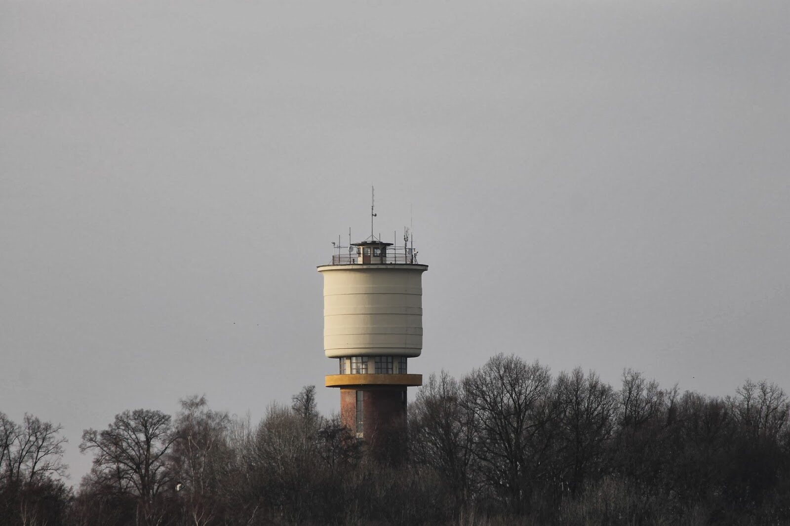

**Oficiálně jsme uveřejnili náš projekt webkamery. Webkameru naleznete na adrese [http://webcam.hkfree.org](http://webcam.hkfree.org "http://webcam.hkfree.org")

Ze stránek webkamery..\
*Pohyblivá webkamera snímající ve vysokém rozlišení panorama Hradce Králové. Kamera je umístěna na nejvyšším bodě ve městě a to na věži vodojemu ([mapy.cz](http://www.mapy.cz/#%21q=50%25C2%25B010%2743.263%2522N%252C%252015%25C2%25B050%2723.443%2522E&t=s&x=15.842473&y=50.178787&z=15&d=coor_15.839845%2C50.178684_1&qp=8.758649_47.602646_19.667453_51.769338_6)) v části Nový Hradec Králové. Snímek se obnovuje každou minutu. Z pořízených snímků se každý den ve 12h a 24h vytváří pohyblivé video. Webkamera udržuje i archiv snímků a videií dostupný pomocí navigačních prvků vlevo. U webkamery je umístěna automatická meteostanice a její údaje jsou vkládány do pořízených snímků. Za možnost umístění na vodojemu, velice děkujeme firmě [Královehradecká provozní a.s.](http://www.khp.cz/)*
