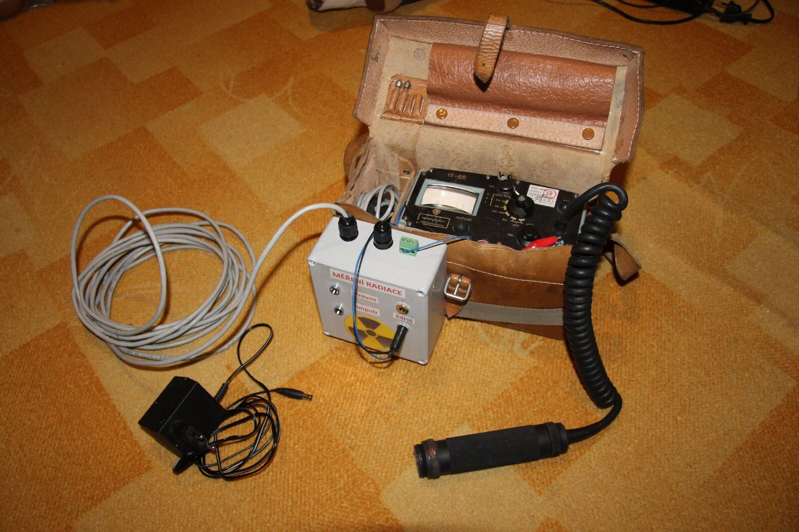

Podařilo se nám uspěšně dokončit další projekt. Jedná se o doplněk k naší meteostanici a to měření přírodního radiačního pozadí. Zařízení měří minutově přicházející gama záření a aktuální hodnotu zobrazuje spolu s meteo daty v naší [webkameře](http://webcam.hkfree.org). Naměřená hodnota je přepočítávána do jednotky aktivity [Becquere](http://cs.wikipedia.org/wiki/Becquerel)l.  Více o měření radioaktivity se dočtete [zde.](http://atominfo.cz/2012/05/sievert-becquerel-rentgen-jak-merime-radioaktivitu/)V plánu máme nyní sběr dat a jejich publikace ve formě grafů.\
Více informací o tomto zařízení a fotky ze stavby najdete [zde](http://pajavlk.blogspot.de/2014/02/mereni-radiacniho-pozadi-zeme-pres.html)
