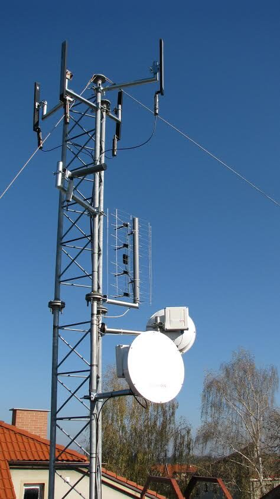

AP Plotiště nyní pokrývá své okolí již pomocí čtyř sektorů a nově má také posílenou zálohu směrem na [AP](http://mapa.hkfree.org/?bod=2486) [Karosárna](http://mapa.hkfree.org/?bod=2486). AP Kalinka je po kompletní rekonstrukci anténních systémů. Nově je zde nasazeno 6 moderních skalárních sektorů. Spoj na AP Dvorská je po rekonstrukci a hlavní páteř přes [AP Postman](http://mapa.hkfree.org/?bod=267) je nyní celá v pásmu 10GHz.
