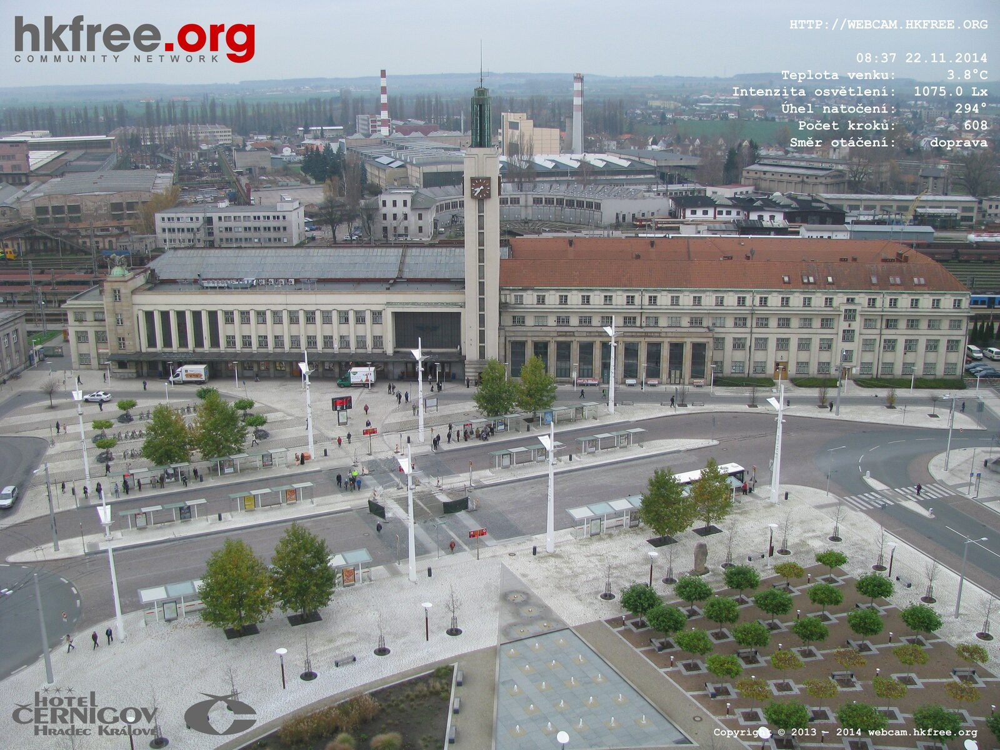

S novou verzí stránek zveřejňujeme i novou [webkameru](http://webcam.hkfree.org/#cernigov "Webkamera Černigov") na hotelu [Černigov](http://www.hotelcernigovhradeckralove.com/cs/ "Hotel Černigov *** - future member of the Clarion family"). Aktuálně dost diskutované téma, nyní můžete sledovat Riegrovo náměstí z nejvyšší budovy ve městě. Kamera je stejně jako na vodojemu otočná. Zabírá prostor před nádražím a i za ním. Sledujte velice zajímavé videa z této webkamery. Kamera na vodojemu je zaměřena převážně na počasí a tato kamera na Černigově zase na dopravní ruch. Vzhledem k omezení [ÚOOÚ](https://www.uoou.cz/ "Úřad pro ochranu osobních údajů") nedrží kamera archiv snímků, pouze videa o menším rozlišení.

***EDIT 19.12.2014***

**Napsali o nás:**

[http://hradecky.denik.cz/zpravy\_region/unikatni-kamera-snima-prostor-pred-hlavnim-nadrazim-20141126.html](http://hradecky.denik.cz/zpravy_region/unikatni-kamera-snima-prostor-pred-hlavnim-nadrazim-20141126.html)

[http://www.hkcity.cz/2014/11/23/na-cernigove-je-nova-webkamera-sledujte-ruch-pred-nadrazim/](http://www.hkcity.cz/2014/11/23/na-cernigove-je-nova-webkamera-sledujte-ruch-pred-nadrazim/)

[http://www.vlaky.net/zeleznice/spravy/5525-Kralovehradecke-nadrazi-z-nadhledu/](http://www.vlaky.net/zeleznice/spravy/5525-Kralovehradecke-nadrazi-z-nadhledu/)

[https://www.facebook.com/video.php?v=10153350616453508&set=vb.255683093507&type=2&theater&notif\_t=video\_processed](https://www.facebook.com/video.php?v=10153350616453508&set=vb.255683093507&type=2&theater&notif_t=video_processed)

[http://www.5plus2.cz/?e=NA-HRADECK&d=05.12.2014#strana=6](http://www.5plus2.cz/?e=NA-HRADECK&d=05.12.2014#strana=6 "5plus2")
