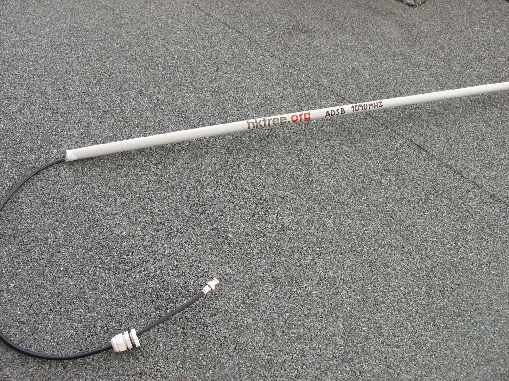
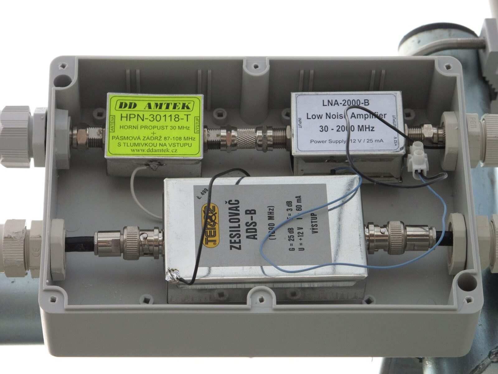
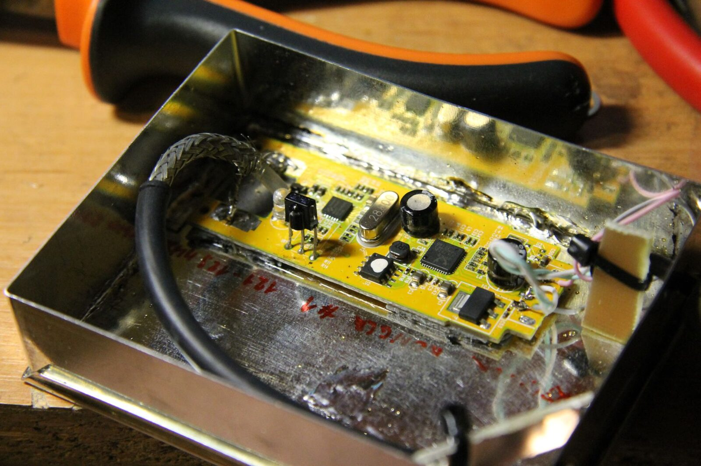
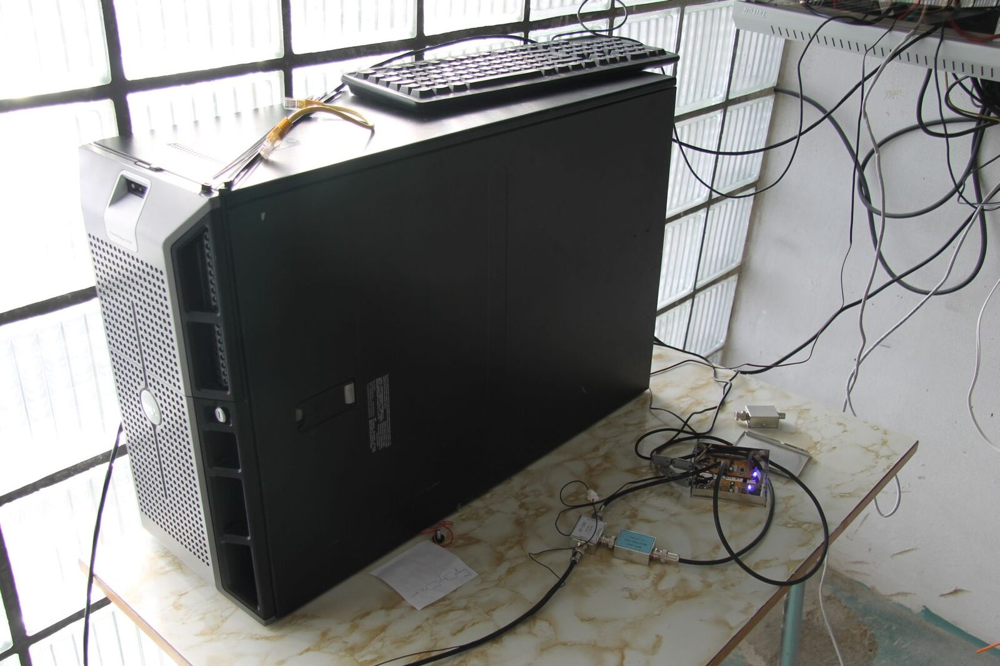
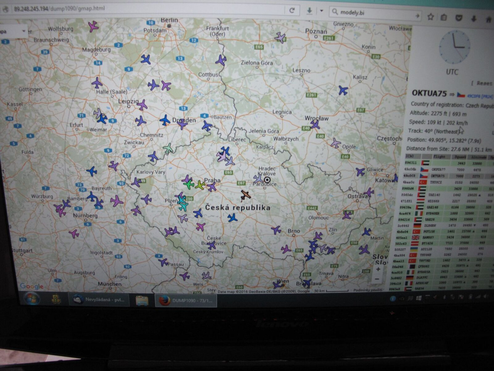
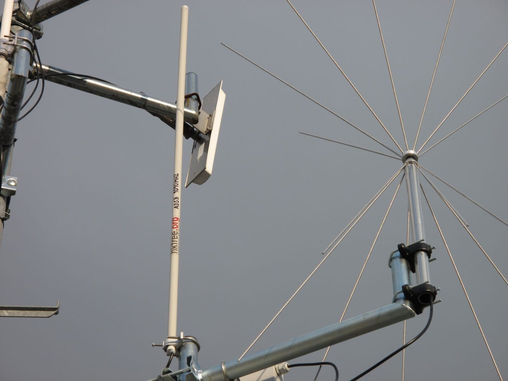
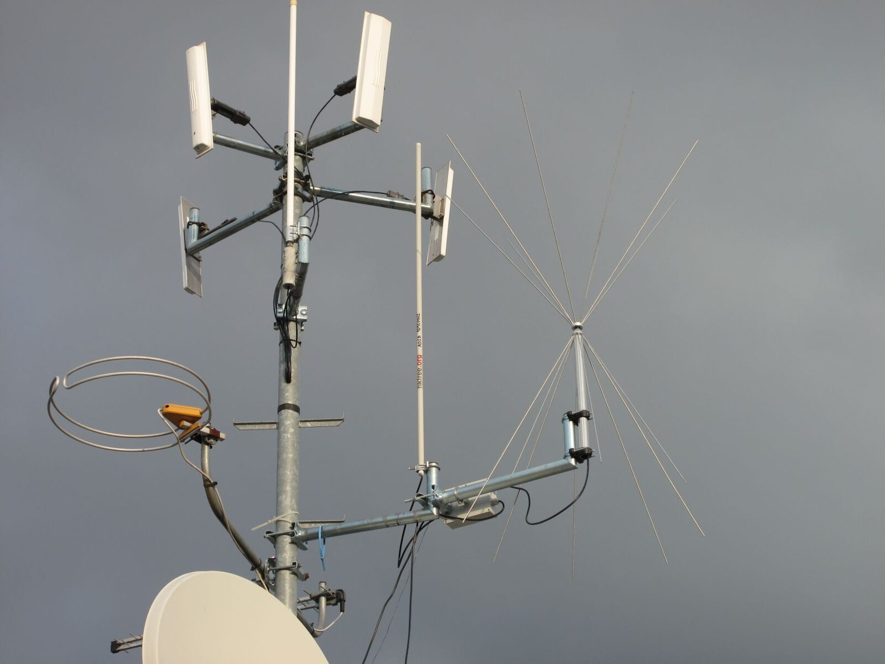
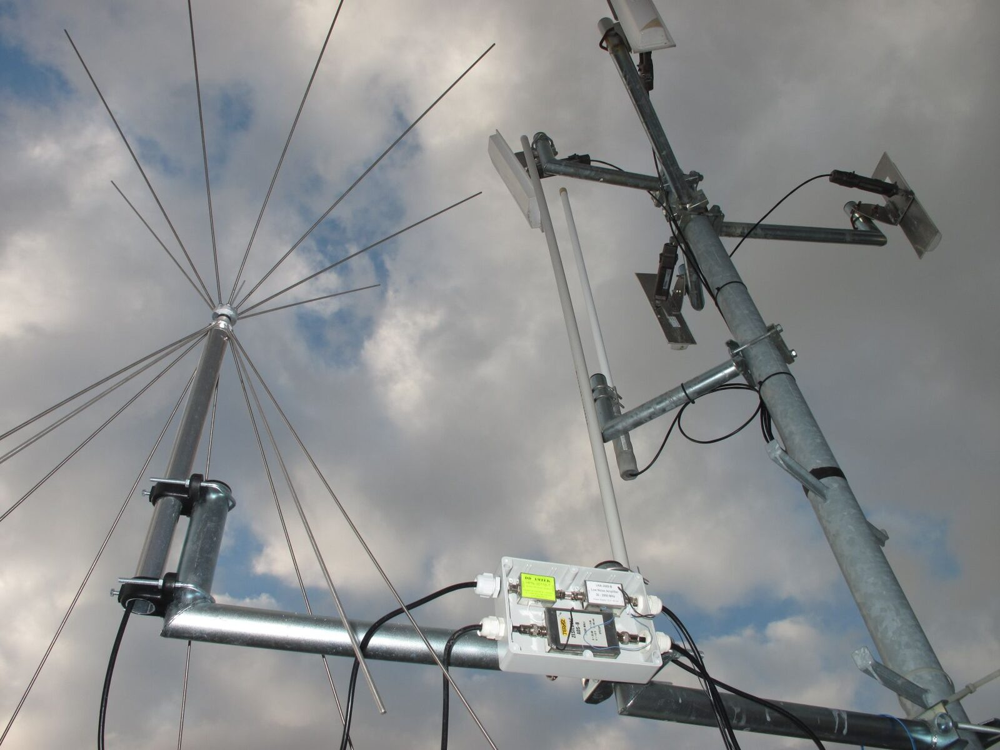

Projekt sledování letících letadel pomocí [ADS-B.\
](http://www.flymag.cz/article.php?id=9063)Sledujeme data z několika přijímacích stanic našich členů v Hradci i Pardubicích, data z těchto stanic se následně odesílají na server Hkfree kde se zpracovávají a zobrazují na mapě. Tyto data se odesílají i např. na oblíbený [https://www.flightradar24.com](https://www.flightradar24.com)

Nejvýkonnější stanice je umístěna na střeše paneláku na Moravském předměstí. Představme si teď její technické řešení.

Nejzákladnějším a nejdůležitějším prvkem je „anténa“. Po několika pokusech s typy antén se jako nejlepší ukázala tzv. Kolineární anténa. Postavena byla podle [http://balarad.net/](http://balarad.net/)Má dvanáct prvků a na výšku skoro 1,5 metru. Tato anténa je všesměrová a chytá tedy letadla letící ve všech směrech okolo stanice.

Dalším důležitým prvkem je pásmová propust a zesilovač. Pásmová propust slouží k tomu aby propustila pouze signál na frekvenci 1090Mhz kde vysílají odpovídače letadel. Ve městě je její použití nezbytné jelikož je všude na pásmu obrovské rušení typu GSM apod. která nám spolehlivě zahltí přijímač a chytáme potom minimum signálů. Hned za propustí je řazený zesilovač. Zesilovač jednak pokrývá ztráty na anténním svodu k přijímači a také zesiluje slabé signály z daleko letících letadel.

Předposlední věcí je [SDR](https://cs.wikipedia.org/wiki/Softwarov%C4%9B_definovan%C3%A9_r%C3%A1dio) přijímač. Slouží k příjmu signálu, jeho zdigitalizování a distribuci do PC. Používáme upravené a odrušené USB SDR Dongle které jsou původně určené k přijmu DVB televize.

Poslední věcí je pak zpracování dat a jejich odesílání přes síť ke zpracování. O to se stará linuxový stroj (může to běžet ale např. i na Raspberry)

Výsledkem je finální zobrazení dat na mapě. Zobrazují se všechny informace které dané letadlo vysílá + dochází k výpočtu pozic u letadel ([MLAT](http://www.multilateration.com/ads-b.html)) které vysílají data bez aktuální polohy.

Pokud vás to zaujmulo, každý má dveře otevřené, kdokoli si může takovouto stanici postavit a data z ní potom posílat k nám.  Čím více stanice v okolí, tím přesnější výpočet MLAT pozic letadel. Naučíte se např. vyrobit vlastní anténu, nastavit optimálně zařízení a hlavně získáte cenné zkušenosti. Případně vám poradíme pokud chcete něco vědět nebo se zeptat. Více informací získate v naší [interní diskuzní skupině „Vyvoj“.](http://wiki.hkfree.org/Diskusn%C3%AD_skupiny_-_news)

Data z této stanice a dalších z okolí najdete na veřejně přístupné adrese [http://sdr.hkfree.org/](http://sdr.hkfree.org/)

O dalším z projektů si povíme v dalším díle.

Na závěr ještě několik fotek z realizace.

  

Sdružení je otevřené všem nápadům, chcete realizovat nějaké zařízení ale chybí vám finanční nebo morální podpora? Přidejte se k nám, jedním z cílů sdružení je „sdružovat zájemce o výzkum, vývoj a testování produktů a aplikací v oblasti informačních a komunikačních technologií.“

Pavel Vlček
