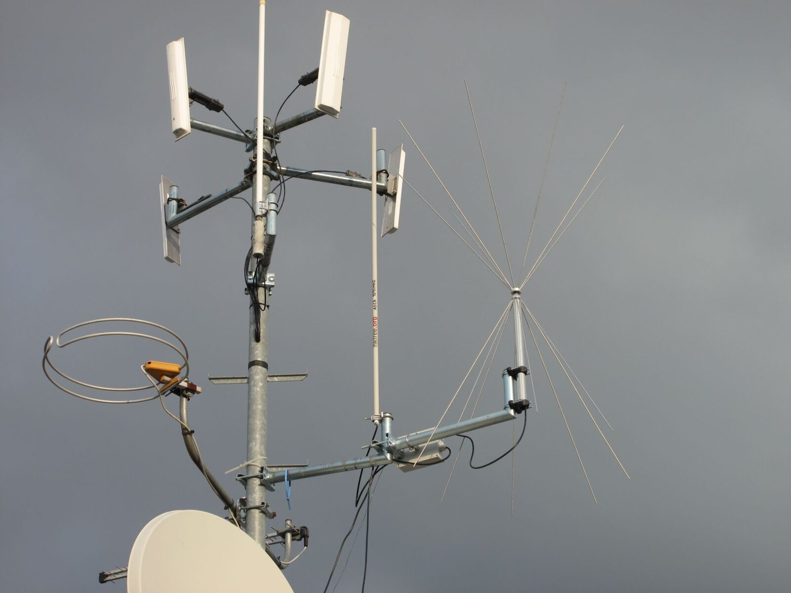
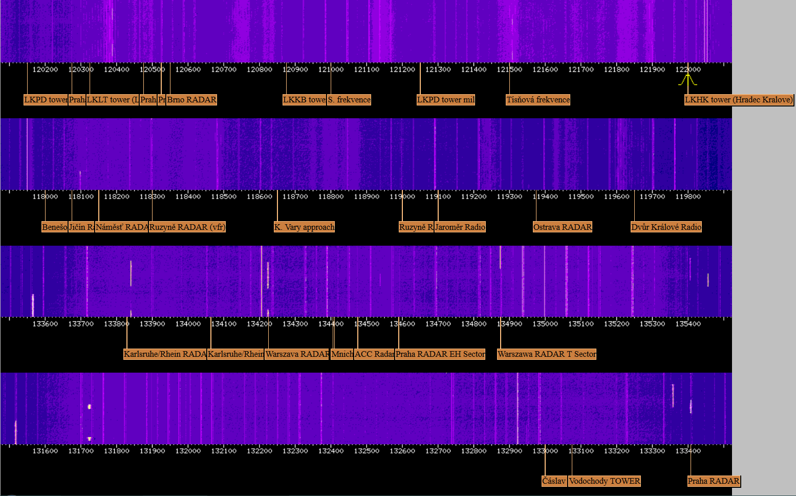

Rád bych představil několik projektů které vznikají za podpory sdružení Hkfree.org.

Prvním z nich je příjem **ADS-B**.\
Více informací o tomto projektu naleznete [zde.](http://www.hkfree.org/?p=2200)

Druhým projektem je\
**WebSDR rádiová stanice**.\
Více informací o tomto projektu naleznete [zde.](http://www.hkfree.org/?p=2233)

**Sdružení je otevřené všem nápadům**, chcete realizovat nějaké zařízení ale chybí vám finanční nebo morální podpora? Přidejte se k nám, jedním z cílů sdružení je *„sdružovat zájemce o výzkum, vývoj a testování produktů a aplikací v oblasti informačních a komunikačních technologií.“*
