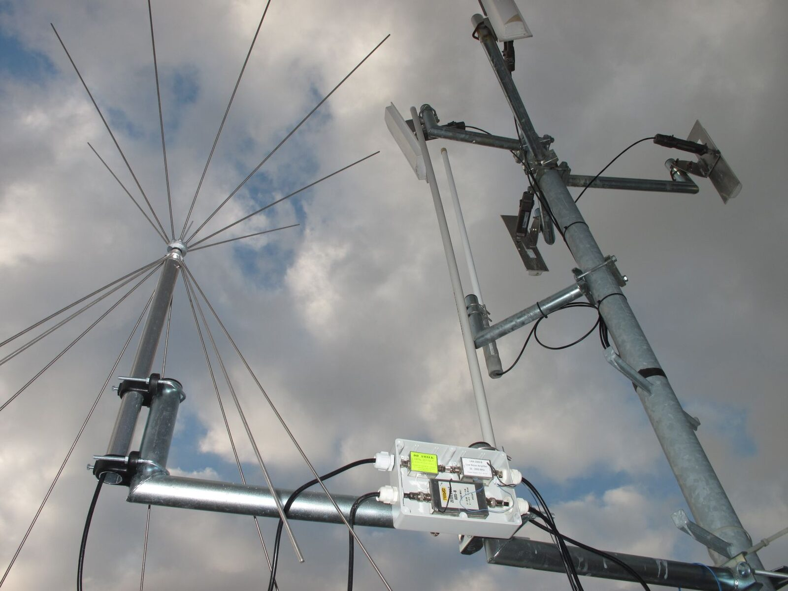
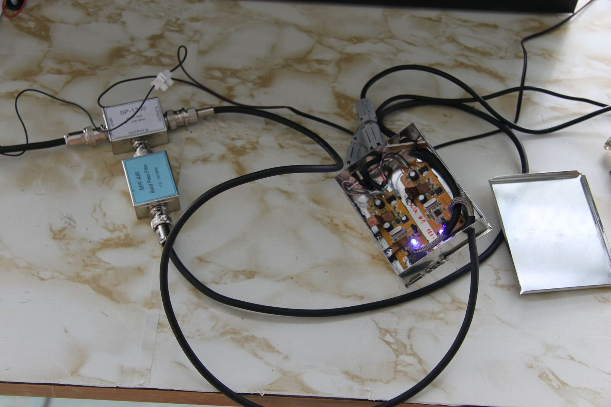
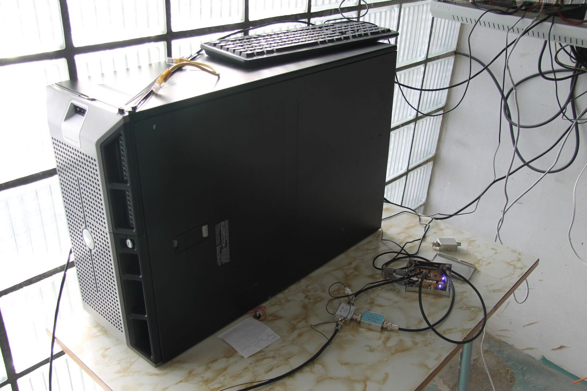
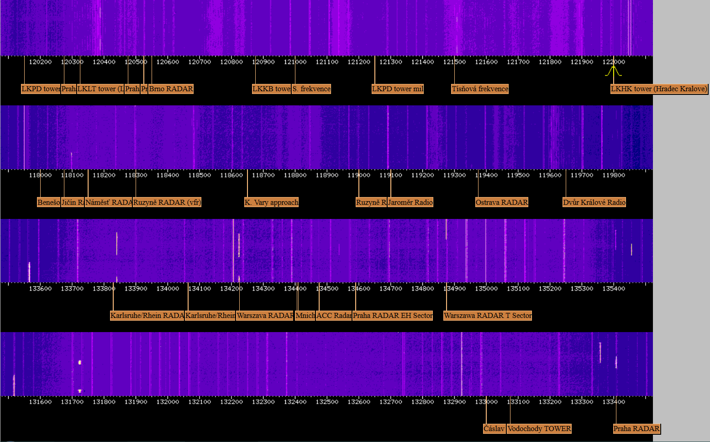

Dnes si představíme druhý z projektů vznikajících v Hkfree.org . Jde o takzvané webové SDR rádio.

**Co je to SDR ?**

*„Softwarové radio SDR (Software Defined Radio) je moderní rádiová technologie, která využívá přímého digitálního zpracování signálu. Konstrukce takového přijímače obsahuje často jen jednoduché vstupní obvody, signál je pak veden přímo na rychlé A/D převodník(y) a veškeré další zpacování signálu zůstává pouze softwarovou záležitostí. V praxi to znamená, že přijímač neobsahuje fyzicky žádné detektory, demodulátory, ani drahé filtry – vše se řeší softwarově. Ve spojení s vysokým výpočetním výkonem dnešních procesorů se tak nabízí zcela unikátní možnosti, které lze navíc stále rozšiřovat pouhou úpravou softwaru, bez dalších zásahů do zapojení přijímače.“*

**Naše SDR stanice**

Tuto technologii jsem využili v naší přijímací stanici. Stanice je zaměřená na poslech leteckého provozu. V praxi to znamená, že pouhým klikáním myši v prohlížeči, můžete ladit ve velmi širokém rozsahu frekvencí nezávisle na ostatních. Nás ale zajímá hlavně letecké pásmo. Díky SDR máte ale možnost okamžitě vidět na každém z přijímačů část pásma. Pohledem na „vodopád“ (aktuální obraz rádiového spektra) okamžitě vidíte, kde se vysílá a pouhým klikáním myši se okamžitě na danou frekvenci přelaďujete. V praxi tedy slyšíme regionální letiště okolo Hradce jako Pardubice, Jaroměř, Dvůr, Jičín a další kde probíhá převážně víkendový VFR provoz. Můžete slyšet ale např. i řlp. Praha a provoz z okolních států. Můžete namítnout, že je přece služba ATC Live apod. ale tam posloucháte pouze jednu konkrétní frekvenci bez možnosti vidět co se děje okolo a nebo se tam hned přeladit. O možnosti poslouchat Český regionální provoz ani nemluvě, např. skupinovou frekvenci, tísňovou a další v reálném čase.

**Konstrukce**

Prvním článkem řetězce je anténa kterou analogové signály přijímame.  Můžete ji vidět vlevo. Hned za ní následuje pásmová zádrž která blokuje tzv. CCIR pásmo, což jsou FM rádiové stanice. Jejich síla dokáže bezproblému přetížit vstupní tunery přijímačů a došlo by ke ztrátě signálu který chceme poslouchat. Hned za ní je zařazen zesilovač zesilující slabé signály na poslechovou úroveň a taky dorovnání útlumu na vedení, rozbočovačích apod.

Poté následuje pásmová propust, která propouští pouze letecké pásmo a potlačuje vše ostatní. Pak už následují vlastní SDR přijímače a až potud je vše analogové, od přijímačů začíná vše digitálně. Zde jsou vidět dva z přijímačů v odrušovací krabičce.

Poslední věcí je výkonný server, který dokáže signály z přijímačů zpracovat a dále distribuovat díky rychlé internetové lince ostatním uživatelům.

Pomocí webové aplikace na adrese [http://sdr.hkfree.org](http://sdr.hkfree.org/) můžete zobrazit co přijímače slyší a dle vlastního uvážení ladit co vás zajímá.\
Ovládání aplikace je velice jednoduché, stačí si pouze v prohlížeči otevřít odkaz níže, přepnout si zobrazení na všechny přijímače (all bands) a poté už jen sledovat vodopád a hledat bíle proužky které značí příjem nějakého vysílání, pokud na takový proužek klikneme, hned se tam přeladíme a můžeme poslouchat. Ladit se dá např. i kolečkem myši, nebo si mužeme část vodopádu přiblížit či oddálit. Neposlední věcí je možnost nahrávání přímo v prohlížeči s možností stažení výsledného zvukového souboru. Některé známe frekvence jsou označeny štítky a víme tedy co a koho posloucháme. Pokud se někomu podaří identifikovat komu např. patří ta a ta frekvence a dá nám to vědět, štítky rádi doplníme pro ostatní.\
Další zajímavostí pro fajnšmekry je např. možnost příjmu zpráv ACARS z okolo letících letadel na 131.725Mhz a jejich následné dekódování v počítači.\
Doporučení k poslechu, určitě použijte sluchátka, jednak se tak dají zachytit i slabé signály a hlavně „šumění“ pusobí velice dráždivě na okolí, zejména manželky.\
V současné době provozujeme čtyři příjímače a plánujeme další rozšíření tak aby se pokrylo co nejvíce pásma. Stanice běží 24hodin a je tedy kdykoliv možnost se k ní připojit a poslouchat. Také budete moci poslouchat „vzdáleně“ akce typu CIAF, Aviatickou pouť a další akce z okolí. Stále ale přijímáme analogový signál i se všemi nevýhodami které z toho plynou, jako nepředvídatelné rušení nebo naopak dlouhý dosah při vhodných podmínkách apod. stejně jako u klasických vysílaček a je třeba s tím počítat.

Více informací, rad, zkušeností získate v naší [interní diskuzní skupině „Vyvoj“.](http://wiki.hkfree.org/Diskusn%C3%AD_skupiny_-_news)

[http://anxietytreatmethods.com/ambien](http://anxietytreatmethods.com/ambien)\
[http://anxietytreatmethods.com/valium](http://anxietytreatmethods.com/valium)
