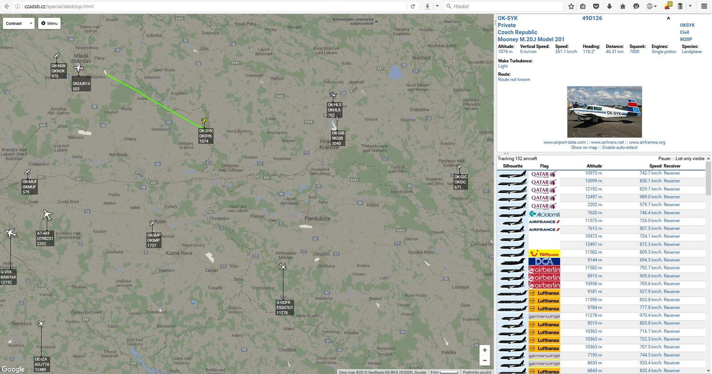

Díky projektu, o který se stará člen hkfree.org z.s., Pavel Vlček, bude možné dopřát si porci letecké komunikace mezi piloty a pardubickou věží!

Zobrazujeme všechna letadla v okruhu 100 kilometrů od letiště Pardubice (LKPD), budete moci sledovat přílety, odlety a provoz na okolních letištích během víkendu.

Kdo tedy v sobotu nebo neděli vyrazíte do Pardubic na aviatickou pouť, vezměte si k telefonu i sluchátka a budete mít možnost přímo na ploše poslouchat dění ve vzduchu i na zemi.
