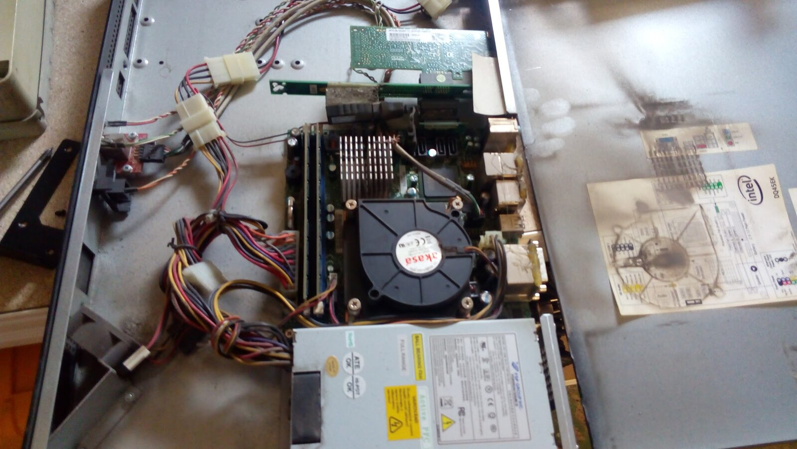

Dnes proběhla výměna důležitého dílu, která mj. zajišťuje provoz sítě v oblasti Libuše. Starý díl už dosluhoval a bylo nezbytné jej vyměnit a nečekat až odejde úplně. Kdyby odešel úplně a neplánovaně, tak by to způsobilo mnohem delší výpadek, než co se stal. To jak vypadá po vytažení z infrastruktury je zachyceno na následující fotce.

Bohužel ne vše zafungovalo na první lusknutí a i zdánlivě banální výměna kus za kus se neobešla bez komplikací, které se „na stole“ neměly šanci projevit a projevily se až při zapojení do infrastruktury. Jeden z problémů se podařilo vyřešit relativně za krátkou dobu a tak postižené oblasti, které jsou na AP Libuše napojeny jako primární linkou jely po zálohách a tedy zpomaleně. Jednalo se především o zbytek Slezského, Malšovice, OLI AP a AP Plácka.\
Jedním z dalších problémů, který je důsledkem vadné karty se podařilo dořešit bohužel až v 17:30, kdy došlo k přesměrování na kartu druhou.\
Náhradní díl byl po zjištění závady obratem objednán a bude měněn zítra, kdy dorazí spediční firmou.
