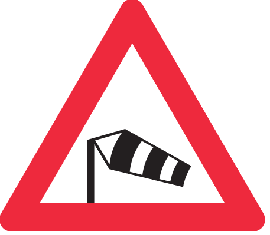

Kalamitní situace se nevyhnula ani vaší síti. Od brzkých ranních hodin svádíme boj s přírodou a snažíme se udržet aspoň základní páteřní body v chodu.

Několik narychlo sehnaných benzínových generátorů bojuje s rozsáhlým výpadkem elektřiny západně od Hradce a drží vzdálené oblasti jako Chlumec, Bydžov a Nové Město.

Omluvte dílčí výpadky a rychlost, hodně oblastí jede po záložních linkách.

Na opravě škod se stále pracuje, záleží jak to počasí umožní.
