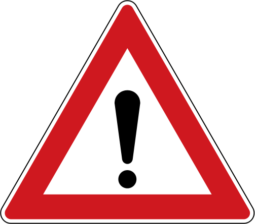

Vážení členové spolku,\
přestože se to neřadí k našem zvyklostem a neděláme to rádi, musíme Vás upozornit na nekalé praktiky společnosti STARNET, s.r.o.

Jak jistě víte spolek nikoho nezavazuje a nikdy nezavazoval, nikdy nepřemlouval a nikdy nijak „nelanařil“. V případě problémů jsme byli schopni poradit nějakou komerční službu, která je schopna nedostatky spolku pokrýt… ale co je moc, je příliš.

Předevčírem se ozval člen z oblasti Malšova Lhoota, že mu bylo telefonicky sděleno ukončení spolkové činnosti [hkfree.org](https://l.facebook.com/l.php?u=http%3A%2F%2Fhkfree.org%2F%3Ffbclid%3DIwAR0BRUgD1979EfwE22DYqGak6GlKAdxrBNb6dYIwPjk6zwwlP2JyRD_xLyg&h=AT02EfpP8mYaepI6ha5euh5bXKJg9fUP5DqHI-bRSRzA8HbuAGCttv0OfSaOF9UE2UkFXS6wlE57vvjzhaDwgOYW-AMt_ayp742VfXp-KdoLTFkthGHW8nAGejExf78UDD3Vd-oQjZKDBOSxRivtHxS7FTiVkURJN4cyMOpSjWYFA9lNH4mNPZLnONzSD_bJF4LEg_wwjJAd5bY-b-cOaUwRUpt0Ktp9dROVicD_vDv4YKiE30Z2gM8-TV2Fmh4yk_JkmgP4rED99QNwNqymXWQ6vk-mASQwSa3UPYCN20QsTsL2GpTFkrS46IwJ2cZaad21vj7Y2cqoASWAMF3r_daGonm0QRcoQEUqaziEzUZ5zSRf6u2KOhsCr54DbwsQfHnYjJ-wnc3BP8UAC9egCbE7Z__BVnIVSAdaGsRseSRWSKUsAfCfn5NuajweFRaxmMMckAxP2Kx2MWai7uuHbqu6dQrqMAog70lrh_bwIWv_6TtLhEQfCvXpZiQkawy1rTOoOLcM40l2KZSQstO9Yl0f9nRDfbGqcCSx5JxF5Mnrm2k6UOU6JWX_SYFB0PjyOjD_6-EE2i3zmCQRxJ6RUJyi8pzcA3NU5uBCXzLVKhOlcR3exCovjzsnByf3C0r97ErQR7DZ5AhTmlHLNm7LI-4py6ZA) a převzetí firmou STARNET, s.r.o. s tím, že je potřeba návštěva jejich technika, výměny zařízení a zároveň podepsání smlouvy.

Jak jistě víte, spolek [hkfree.org](https://l.facebook.com/l.php?u=http%3A%2F%2Fhkfree.org%2F%3Ffbclid%3DIwAR0ubHF80GWFH1fKQkYXOGRKhYHk-auCpwWUKn3_XKjTKqNxqHRc1sOb0O8&h=AT3yLfoVC5p9p-zpptehTrTeNeK-8OumCwNHQ3dVmv_rtGp2gm1vIFW3aj6z-QOZpdaCjtW8MP_jG_nIEd-_A4Abug8Sa3oa0X2pnifLmUPpLjMjUvwei14GROiWhpf9ZOSa5bgYiioqGTXy1V16HUGsEgcHASQzPKe3OfLBJohgLr8CiR2kIqiDr3TvqJVxdWarcXyXqyF4eslaFmM3wdUIYw1abOfc7Cog75g1NuEx_g3SBBd-10TKj4x9Gu1MN-eyUBwFbzUE9TjjXlU8abCa-buH3Rp-_W-6k8LbnDArxreGhsnWyCP3QW60392d58jTG3WjITsaHuxy-Pm3IgsFKkqvUpLnqVvI6eKSSUp3MHkPyxHNCHcS7flZ8qd71PTP4dGYFnpzPLyABUJ30-lE9ILD8rZcQ9u41mhKEKb9Eh0kMY0Jgp5C4dHGrioNYp_9-8AgZlwJ2wlc5IfcM_tdF5wHxqtdYiWXzo-z02UBhxIuRfTLr-DLnPmpJaVsI8K8c_DWeVg_UymU-knwEVT0jULe41lBn_Q6VV3HtLUmdC_ieFzE-TsJ1d6vtVCcljVhfeFB_hU1-kr00MN_s18PUOgYh3JlMW_9JxFM3g_R5xuBMHBXXQNRNIDVuqmG-qAAjcjMjvE8T1D8NvPotultb460) nemá žádné smlouvy. Všichni členové jsou ve spolku připojeni dobrovolně. Spolek není a ani nemůže být nikým a ničím koupen.

Toto jednání považujeme minimálně za neetické a v rozporu s dobrými mravy, bohužel, o společnosit STARNET, s.r.o. toho po internetu koluje tolik, že není problém si vyhledat desítky podobných případů. Tato společnost je velmi agresivní, nebere si servítky. Jsou zde případy ustřihaných kabelů, sundaných spojů, úmyslného rušení, apod.

Členovi jsme sdělili, že záleží samozřejmě na jeho rozhodnutí, ze strany spolku se o žádnou změnu nejedná! Nemáme v plánu Vás nijak přemlouvat, pouze upozornit na podvodné jednání.

Pokud se setkáte s podobným přístupem a nebude Vám to lhostejné, kontaktujte prosím svého správce oblasti, případně Aničku na 608 10 10 70 a sdělte svoje zkušenosti. Dle dostupných informací budeme podnikat další kroky.

Samozřejmě můžeme komentovat zde v diskuzi.

Děkujeme.
