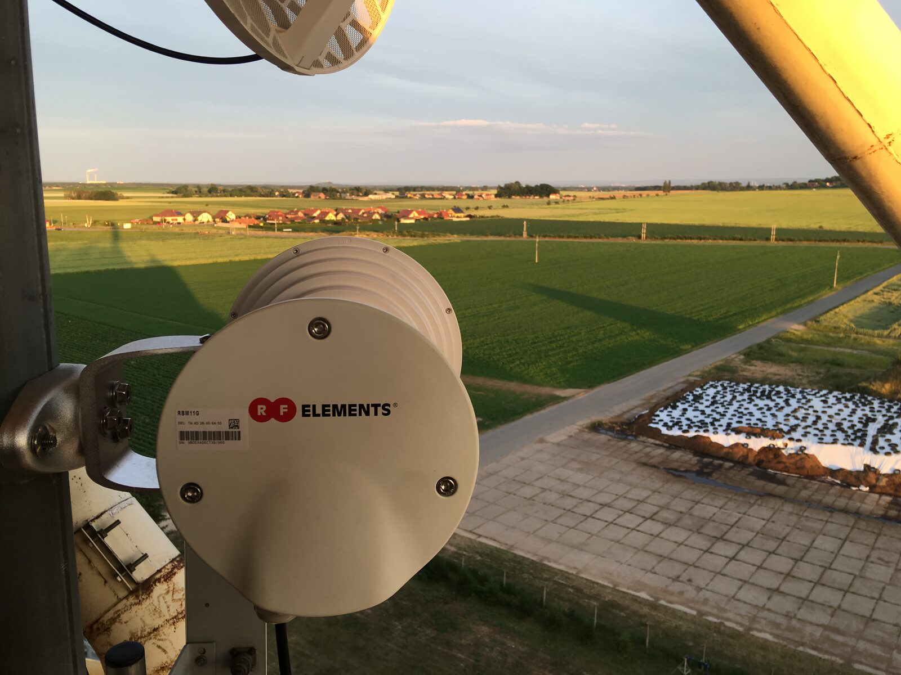

Oblast Lhota pod Libčany, lokalita “Za drahou” — dvě hodiny práce dvou dobrovolníků stačí na nové rychlejší a stabilnější pokrytí na několik let dopředu. Členové sdružení v této oblasti nyní využívají moderní WiFi 5 (802.11ac) na platformě RouterBoard a RF elements.
