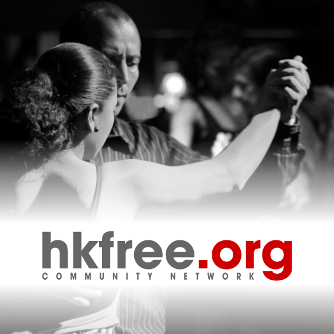

V pořadí již 7. reprezentační ples HKfree.org se uskuteční **8\. února 2020** od 8 hodin v **KD Střelnice** v Hradci Králové. K tanci tradičně zahraje královehradecká kapela Blue Band, v malém sále se můžete těšit na legendu DJ Pavla Ferbase a mladou rockovou kapelu Crash N‘ Do. Součástí večera budou i zajímavá vystoupení a bohatá tombola, jejíž výtěžek opět poputuje na dobročinné účely. Zveme všechny naše členy a sympatizanty na večer plný tance a společenské zábavy. Vstupneky bude možné od 1.11. 2019 zakoupit v prodejní síti [Ticketstream](https://www.ticketstream.cz/akce/6-reprezentacni-ples-hkfree-org-123035). Případné dotazy můžete směřovat na e-mail **[ples@hkfree.org](mailto:ples@hkfree.org "ples@hkfree.org").** Těšíme se na Vás!
