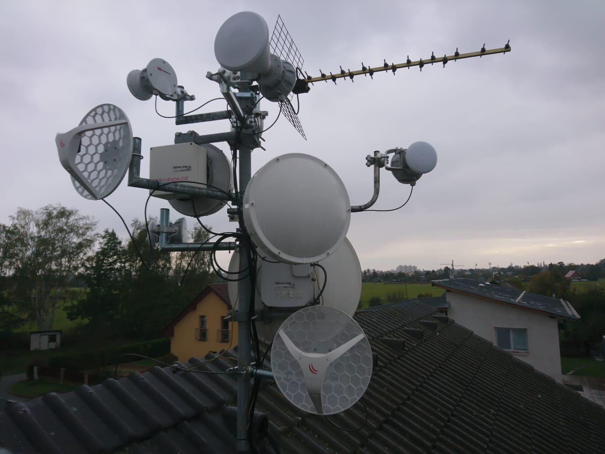
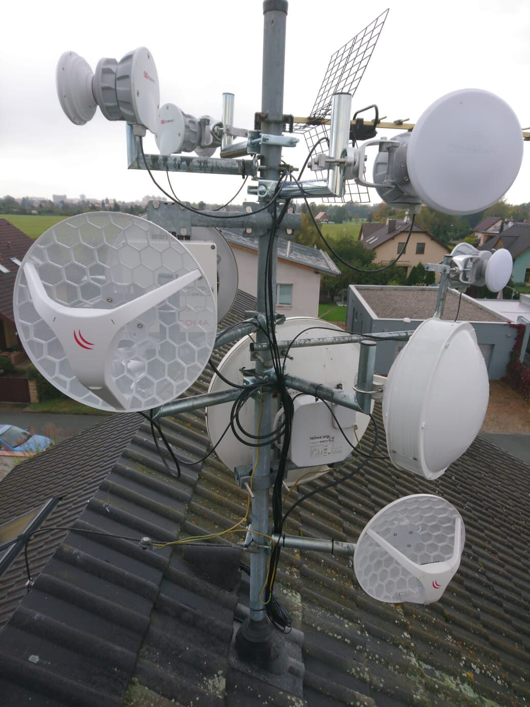
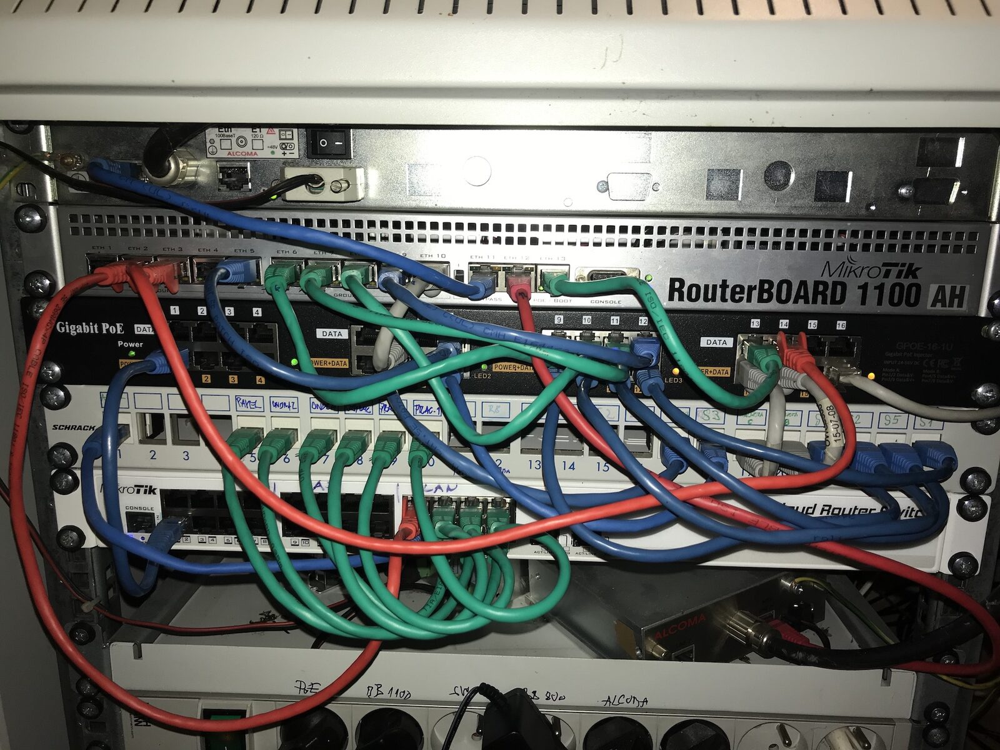
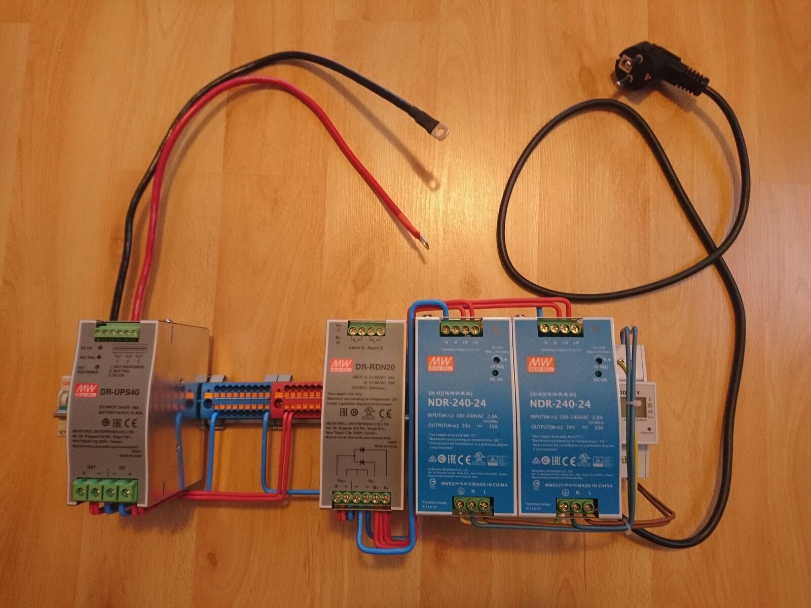
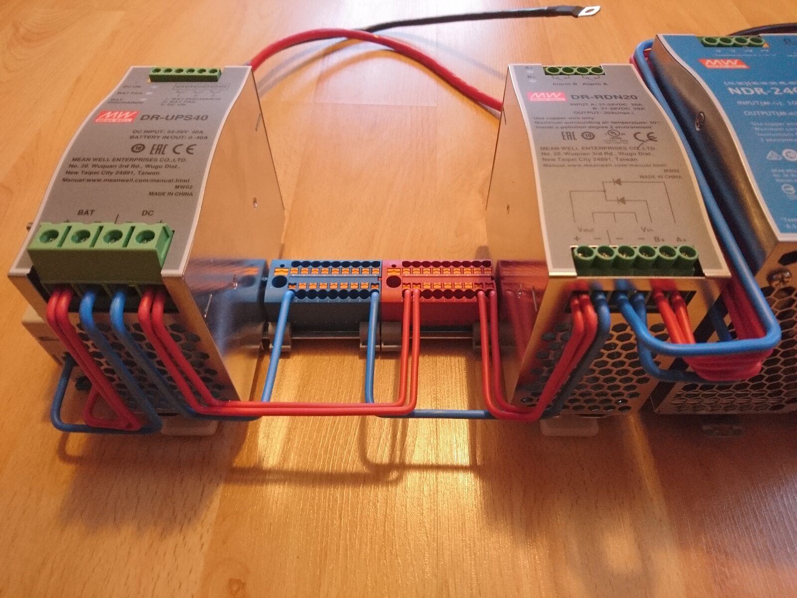

V sobotu proběhla první část modernizace na AP MalhotaA v Malšově Lhotě. Vyměnili jsme sektorové antény za nové dvoupolarizační, podporující standard 802.11ac. Následovat by mělo v nejbližších dnech i posílení páteřní linky na 200 mbit a přestavba napájení celého AP pomocí dvou redundatních zdrojů a UPS modulu s baterií. AP by tak mělo přestát i několikahodinový výpadek proudu.

Další plán rozvoje je příprava jednoho nebo dvou menších subAP pro rozložení zátěže a lepší připojení více členů.

