\
👉 Předělali jsme nové sektory na AP Yzop.\
👉 Ve druhé fázi upgradů na AP Oli jsme upgradovali staré 5GHz sektory za 5GHz RF Elements s Horn anténami s MIMO ac deskami MikroTik. Zároveň jsme další přidali a rovnoměrně tak pokryli celých 360° kolem AP.\
👉 AP Roudnička má novou 300mbit linku.\
👉 V Dobrušce byl vyměněn poslední starý router za APU\
👉 Byl Vyřešen upgrade AP Střezetice – Statek. Nově až 400 Mbps do veřejné sítě.\
👉 Upgradovali jsme AP Budvárek. Nové AC sektory, router a linka na Alcomě 165mbps. Zlikvidovali jsme tak další 5GHz páteřní spoj a zároveň máme zálohu mezi Budvárkem a Svinarami. Dvě oblasti dosud bez zálohy tak nyní budou mít záložní linky.\
👉 Během dvoudenní akce se podařilo zásadně zmodernizovat AP Rusek.\
👉 Proběhlo další kolo upgradů v Plotištích nad Labem.\
❗ Máte chuť se k nám přidat a něco se při tom naučit? Ozvěte se! 😉

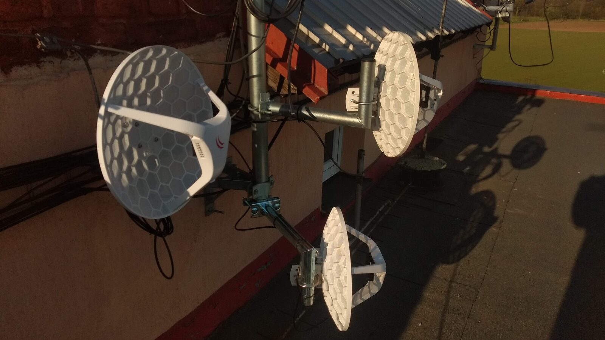
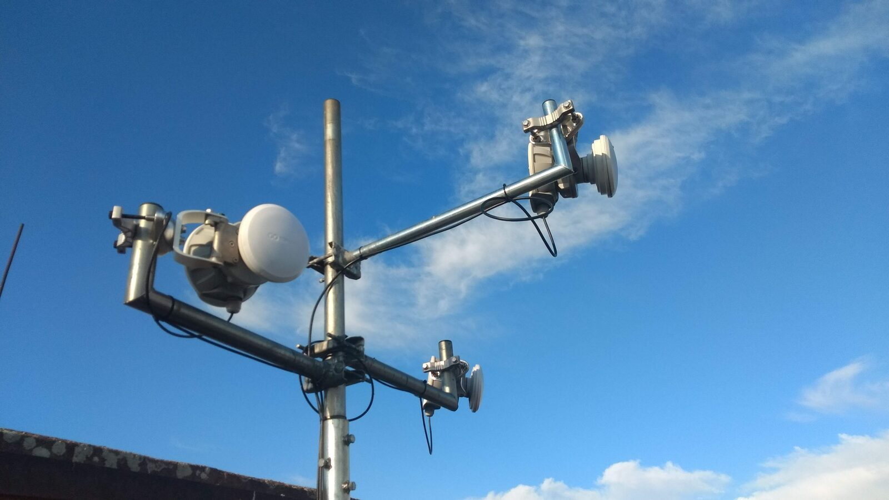
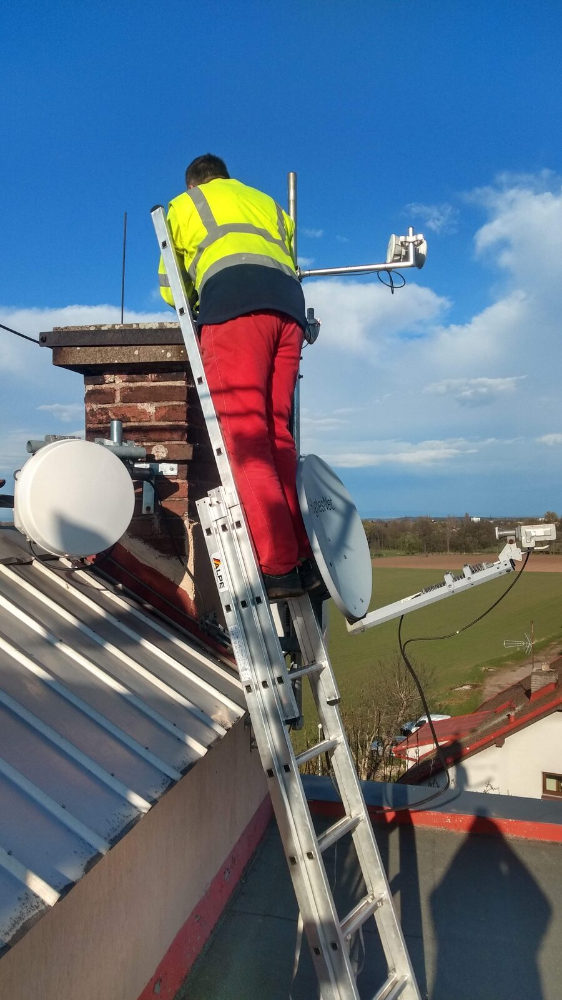
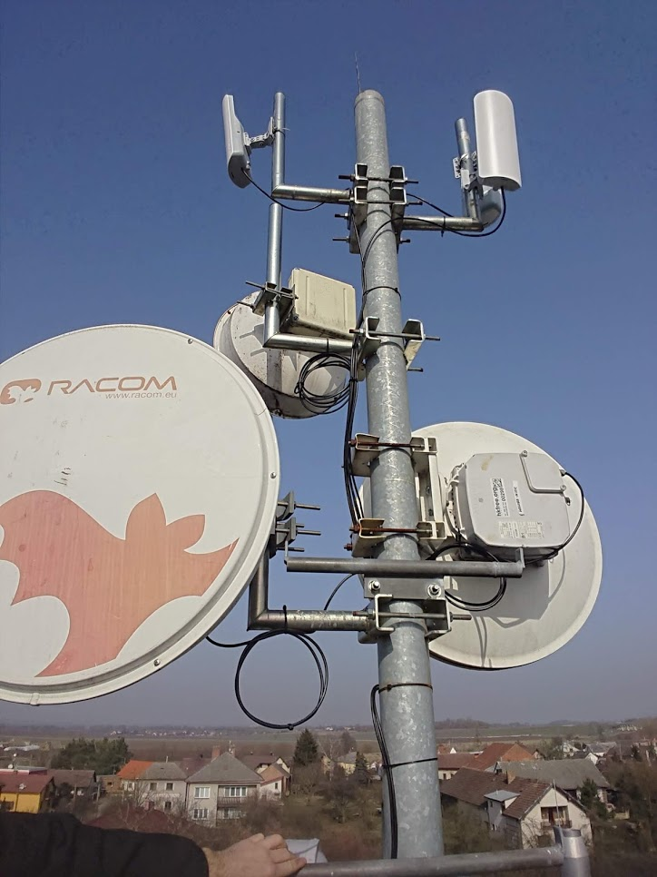
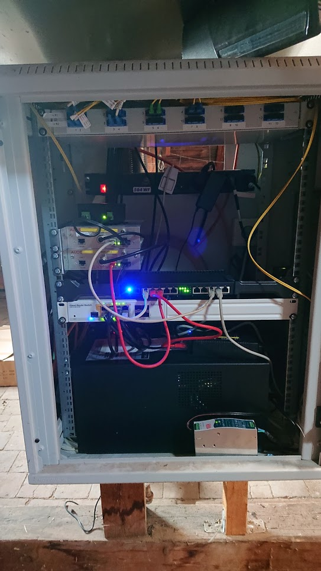
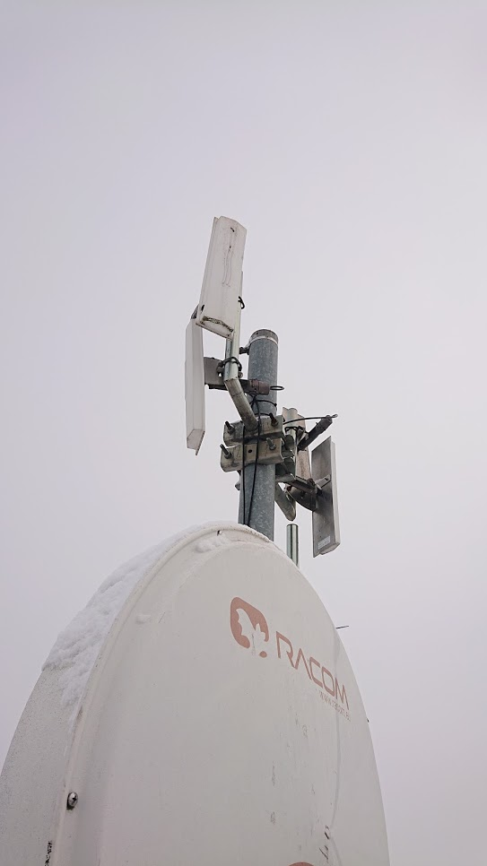
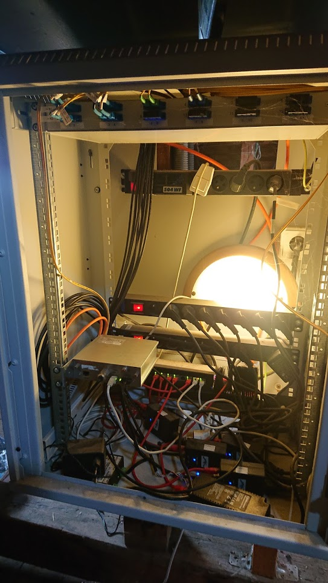
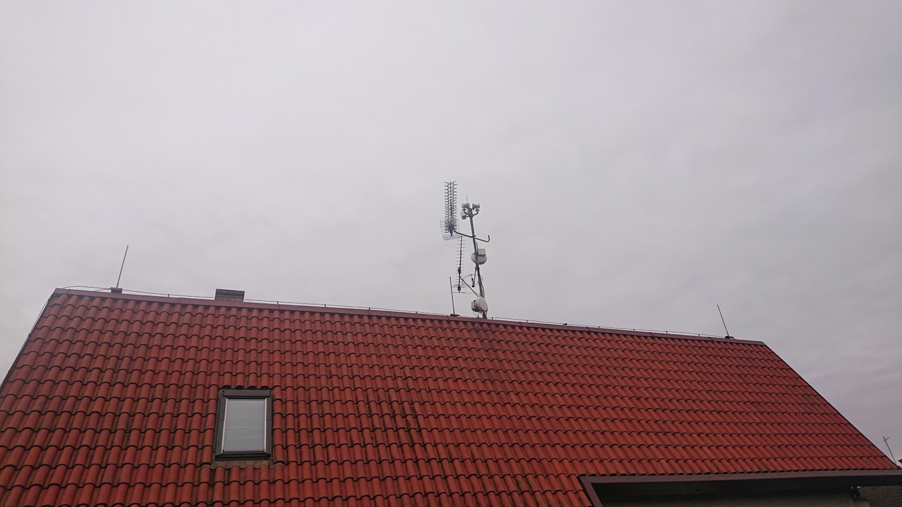
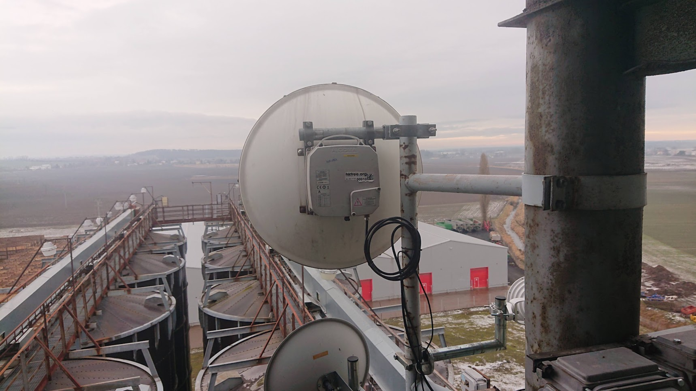
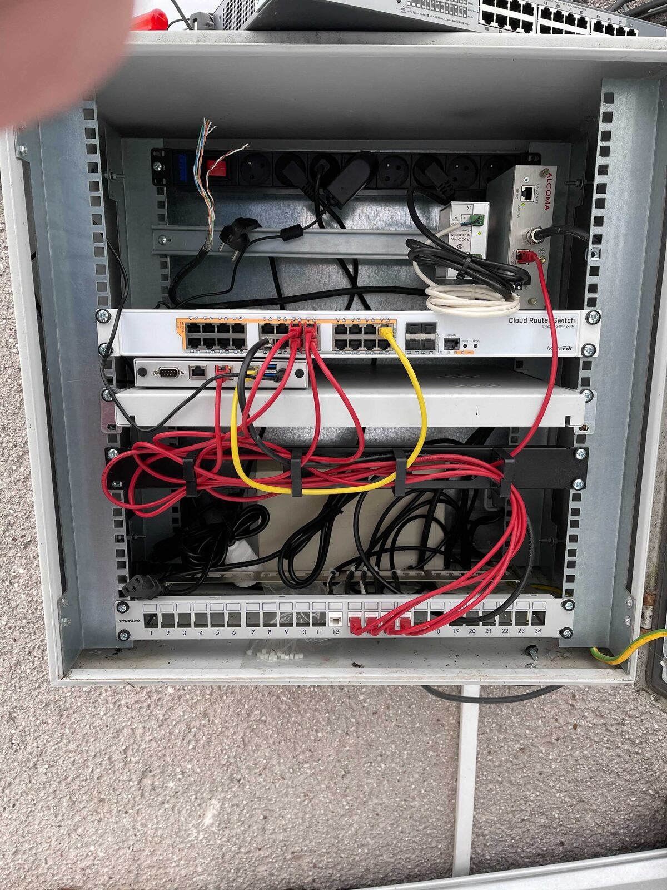
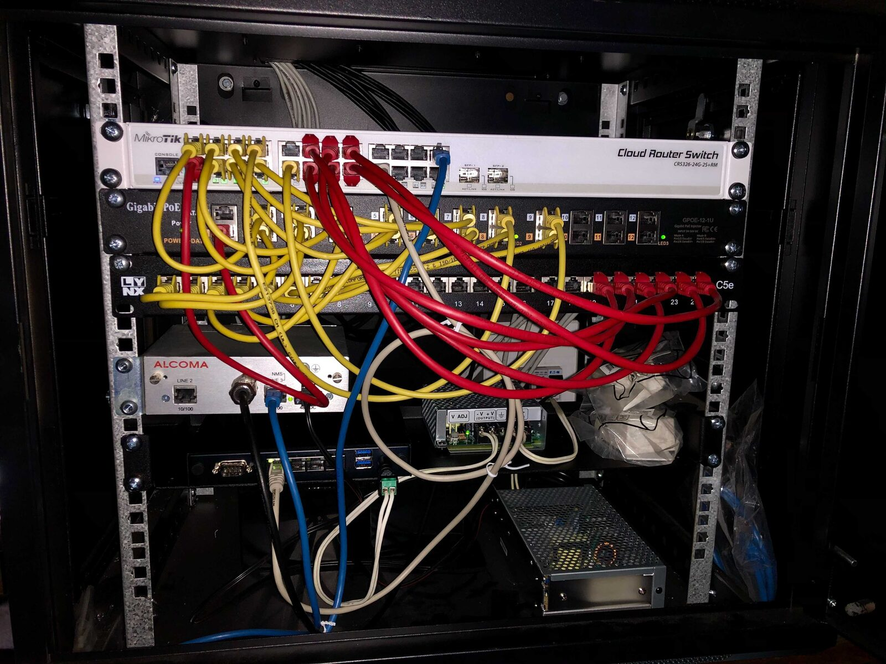
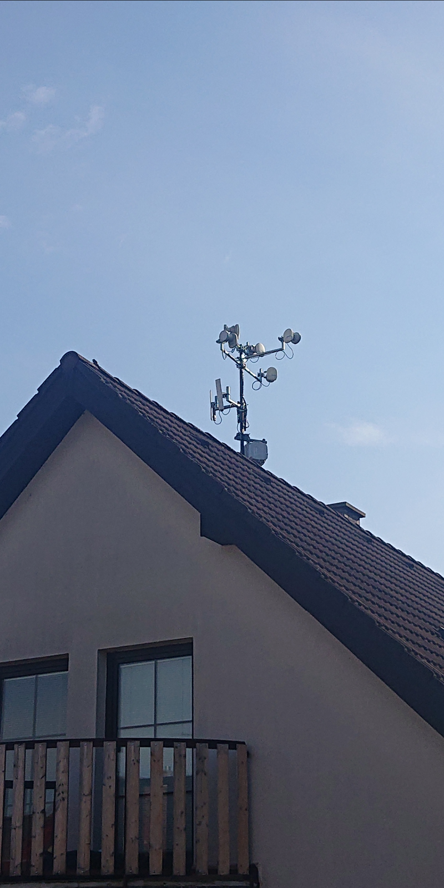
